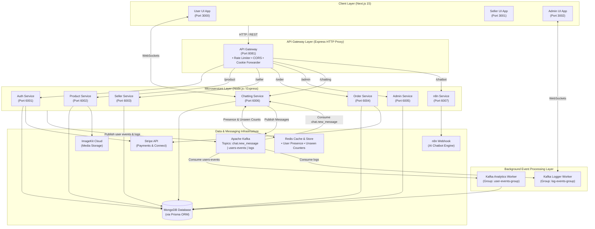
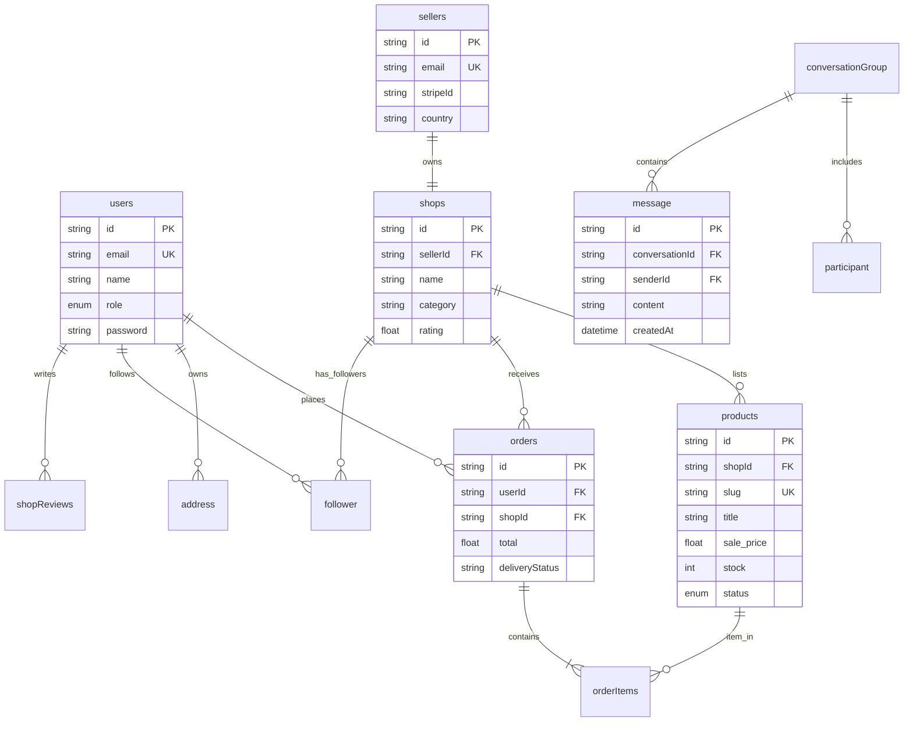

# LocalGoods — Event-Driven Microservices E-Commerce Monorepo

<div align="center">
  
</div>

<p align="center">
  <b>An event-driven microservices marketplace architecture connecting local artisans and antique dealers with heritage goods enthusiasts.</b>
</p>

---

<details open>
<summary><b>1. Overview</b></summary>

<br/>

**LocalGoods** is a production-grade e-commerce platform built as an **Nx Monorepo**. The system addresses the technical and business challenges of supporting local artisans, antique vendors, and buyers by unifying multi-role user management, real-time messaging, asynchronous event analytics, soft-deleted inventory management, and automated seller payouts.

The platform is engineered around an **event-driven microservices architecture** that decouples user interaction, payment processing, real-time chat, background analytics, and system logging. By using **Apache Kafka** for event streaming and **Redis** for in-memory presence detection and caching, LocalGoods offloads high-frequency database operations to asynchronous background workers—ensuring low latency and high availability across user-facing applications.

The workspace is organized into **7 Express microservices**, **2 background workers**, and **3 Next.js 15 client UIs**, coordinated through shared internal packages for error handling, middleware, database ORM abstractions, and Kafka/Redis client instances.

</details>

---

<details>
<summary><b>2. Key Capabilities</b></summary>

<br/>

### User Storefront & E-Commerce Workflow
* **Dynamic Product Catalog**: Browse, search, and filter heritage products by category, subcategory, price range, brand, ratings, and tags.
* **Shopping Cart & Checkout**: Add/remove cart items with real-time stock updates and coupon verification.
* **Stripe Payment Gateway**: Secure checkout using Stripe PaymentIntents and Hosted Checkout Sessions with server-side validation.
* **User Order Lifecycle**: Complete order history, order details tracking, shipping address management, and delivery status monitoring.

### Seller Dashboard & Shop Operations
* **Merchant Shop Portal**: Customizable shop profile with bio, opening hours, social links, category configuration, and cover banners.
* **Inventory Management**: Product creation with ImageKit image uploads, detailed specifications, pricing, stock levels, and soft deletion/restoration controls.
* **Promotional Events & Coupons**: Create custom discount codes and manage promotional event campaigns.
* **Stripe Connect Onboarding**: Direct automated seller payout setup using Express Stripe Account Onboarding.
* **Follower System**: Buyer-to-shop subscription model enabling sellers to track follower metrics.

### Real-Time Chat & Asynchronous Persistence
* **WebSocket Messaging**: Bidirectional buyer-seller communication with instant message delivery.
* **Redis Presence & Counters**: Live online/offline status tracking (`online:user:${id}`, `online:seller:${id}`) and unread message counters.
* **Kafka Write-Behind Pipeline**: Chat messages are published to Kafka topic `chat.new_message` and flushed in 3-second batches to MongoDB, keeping WebSocket handlers non-blocking.

### Behavioral Analytics Ingestion
* **Real-Time Tracking**: Asynchronous capture of user interaction events (`product_view`, `add_to_cart`, `remove_from_cart`, `add_to_wishlist`, `remove_from_wishlist`).
* **Kafka Stream Processing**: Events are published to `users-events` topic and consumed by [`kafka-service`](file:///d:/LocalGoods/apps/kafka-service/src/main.ts).
* **Profile & Item Analytics**: Background updates to [`userAnalytics`](file:///d:/LocalGoods/prisma/schema.prisma#L320) (bounded to the last 100 actions) and [`productAnalytics`](file:///d:/LocalGoods/prisma/schema.prisma#L306) (views, cart additions, purchases).

### Admin Platform Oversight
* **Platform Governance**: Moderation tools for users, sellers, shops, products, and promotional events.
* **Global Configuration**: Site-wide category management, layout banners, and notifications.
* **Live System Log Streaming**: Real-time log aggregation consuming Kafka `logs` topic and broadcasting output over WebSockets to administrative views.

</details>

---

<details>
<summary><b>3. System Architecture</b></summary>

<br/>

### High-Level Component Architecture



### Microservice Topology & Port Map

| Component | Directory Path | Tech Stack | Port / Role | Primary Responsibilities |
|---|---|---|---|---|
| **`api-gateway`** | [`apps/api-gateway`](file:///d:/LocalGoods/apps/api-gateway) | Express, Proxy, Rate-Limit | `8081` | Central API proxy, CORS policy, IP/User rate limiting, cookie header forwarding. |
| **`auth-service`** | [`apps/auth-service`](file:///d:/LocalGoods/apps/auth-service) | Express, TypeScript, JWT, Nodemailer | `6001` | Multi-role authentication (User, Seller, Admin), OTP verification emails, password hashing, HttpOnly cookie tokens, Stripe seller link creation. |
| **`product-service`** | [`apps/product-service`](file:///d:/LocalGoods/apps/product-service) | Express, ImageKit, Prisma | `6002` | Catalog CRUD, ImageKit media uploads, discount/coupon management, soft deletion/restoration, multi-filter search. |
| **`seller-service`** | [`apps/seller-service`](file:///d:/LocalGoods/apps/seller-service) | Express, Prisma | `6003` | Shop creation & profile management, follower subscription logic, seller dashboard statistics, event creation. |
| **`order-service`** | [`apps/order-service`](file:///d:/LocalGoods/apps/order-service) | Express, Stripe API, Prisma | `6004` | Stripe PaymentIntent & Checkout Sessions, payment status verification, coupon code validation, delivery state workflow. |
| **`admin-service`** | [`apps/admin-service`](file:///d:/LocalGoods/apps/admin-service) | Express, Prisma | `6005` | Platform admin controls, user/seller listing & status moderation, site-wide layout configuration, notifications. |
| **`chatting-service`** | [`apps/chatting-service`](file:///d:/LocalGoods/apps/chatting-service) | Express, WebSockets (`ws`), KafkaJS, Redis | `6006` | Real-time buyer-seller chat, Redis presence & unread counter tracking, Kafka asynchronous batch write-behind DB persistence. |
| **`n8n-service`** | [`apps/n8n-service`](file:///d:/LocalGoods/apps/n8n-service) | Express, Node-Fetch | `6007` | HTTP proxy adapter delegating storefront chatbot requests to an external n8n AI workflow endpoint. |
| **`kafka-service`** | [`apps/kafka-service`](file:///d:/LocalGoods/apps/kafka-service) | Node.js, KafkaJS, Prisma | Background Daemon | Consumes `users-events` Kafka topic. Buffers user interaction events and updates `userAnalytics` and `productAnalytics`. |
| **`logger-service`** | [`apps/logger-service`](file:///d:/LocalGoods/apps/logger-service) | Node.js, KafkaJS, WebSockets | Background Daemon | Consumes `logs` Kafka topic and streams live logs to connected administrative WebSocket clients. |
| **`user-ui`** | [`apps/user-ui`](file:///d:/LocalGoods/apps/user-ui) | Next.js 15, React 19, Tailwind, TanStack Query | `3000` | Customer-facing web app for product discovery, checkout, order tracking, and live chat. |
| **`seller-ui`** | [`apps/seller-ui`](file:///d:/LocalGoods/apps/seller-ui) | Next.js 15, React 19, Tailwind, Recharts | `3001` | Merchant management portal for inventory, sales analytics, promotional events, and payouts. |
| **`admin-ui`** | [`apps/admin-ui`](file:///d:/LocalGoods/apps/admin-ui) | Next.js 15, React 19, Tailwind | `3002` | Administrative panel for platform oversight, user/seller moderation, site layout, and real-time log monitoring. |

</details>

---

<details>
<summary><b>4. System Data & Request Flows</b></summary>

<br/>

### 1. Synchronous HTTP Request Flow (API Gateway Proxy & Auth)

```text
Client Request (User / Seller / Admin UI)
       │
       ▼
┌─────────────────────────────────────────────────────────┐
│                     API Gateway                         │
│  • Checks Origin against CORS Allowlist                 │
│  • Applies Rate Limiter (IP/User Key)                    │
│  • Forwards Cookie Headers & Proxies Request            │
└──────────────────────────┬──────────────────────────────┘
                           │
                           ▼
┌─────────────────────────────────────────────────────────┐
│                    Target Microservice                   │
│  • Route Handler invokes isAuthenticated Middleware     │
│  • Decodes JWT from HttpOnly Cookie / Authorization     │
│  • Verifies Role (isUser / isSeller / isAdmin)           │
│  • Executes Business Logic via Prisma ORM Client         │
└──────────────────────────┬──────────────────────────────┘
                           │
                           ▼
┌─────────────────────────────────────────────────────────┐
│                   MongoDB Database                      │
│  • Executes Query & Returns JSON Response to Client     │
└─────────────────────────────────────────────────────────┘
```

### 2. Real-Time Chat & Asynchronous Write-Behind Flow

```text
User / Seller Client
       │ (Sends Chat Payload over WS)
       ▼
┌─────────────────────────────────────────────────────────┐
│             Chatting Service (WebSocket Server)          │
│  1. Registers Client Connection                         │
│  2. Updates Redis Presence (online:user / online:seller)│
│  3. Delivers Message to Recipient Socket if Online      │
│  4. Increments Unseen Counter in Redis                  │
│  5. Publishes Message Payload to Kafka Topic            │
│     topic: "chat.new_message"                           │
└──────────────────────────┬──────────────────────────────┘
                           │
                           ▼ (Kafka Event Broker)
┌─────────────────────────────────────────────────────────┐
│            Chat Message Consumer (Kafka Worker)         │
│  1. Receives message from "chat.new_message" topic      │
│  2. Appends message to In-Memory Buffer                 │
│  3. Triggers Batch Timer (3000ms flush window)          │
│  4. Flushes Buffer via prisma.message.createMany        │
│  5. Retries in-memory buffer if DB write fails          │
└──────────────────────────┬──────────────────────────────┘
                           │
                           ▼
┌─────────────────────────────────────────────────────────┐
│               MongoDB message Collection                │
└─────────────────────────────────────────────────────────┘
```

### 3. User Interaction Analytics Processing Flow

```text
User Action (Product View / Cart Add / Wishlist Action)
       │
       ▼
┌─────────────────────────────────────────────────────────┐
│                   Kafka Event Producer                  │
│  Publishes event payload to topic: "users-events"       │
└──────────────────────────┬──────────────────────────────┘
                           │
                           ▼
┌─────────────────────────────────────────────────────────┐
│             Kafka Analytics Worker (kafka-service)      │
│  1. Consumes event from "users-events" topic            │
│  2. Validates event action type                         │
│  3. Pushes event into in-memory process queue           │
│  4. Flushes queue every 3000ms                           │
│  5. Upserts userAnalytics (shifts window if > 100 items) │
│  6. Increments views / cartAdds / purchases counters in │
│     productAnalytics                                    │
└──────────────────────────┬──────────────────────────────┘
                           │
                           ▼
┌─────────────────────────────────────────────────────────┐
│           MongoDB userAnalytics & productAnalytics       │
└─────────────────────────────────────────────────────────┘
```

</details>

---

<details>
<summary><b>5. Database Architecture & Schema Design</b></summary>

<br/>

The persistence layer utilizes **MongoDB** via **Prisma ORM** ([`prisma/schema.prisma`](file:///d:/LocalGoods/prisma/schema.prisma)). Native MongoDB ObjectIDs (`@map("_id") @db.ObjectId`) are used for document identifiers and cross-collection references.



### Strategic Schema Design Patterns

1. **Relational Document Integrity in NoSQL**:
   * MongoDB relationships (e.g., `shops.sellerId` linked to `sellers.id`) use Prisma relation directives to enforce consistency at the application layer while storing indexed ObjectIDs.
2. **Soft Deletion Pattern**:
   * Models [`products`](file:///d:/LocalGoods/prisma/schema.prisma#L162), [`shops`](file:///d:/LocalGoods/prisma/schema.prisma#L90), and [`sellers`](file:///d:/LocalGoods/prisma/schema.prisma#L120) incorporate `isDeleted: Boolean` and `deletedAt: DateTime?` flags. Soft-deleted records preserve transaction history in completed orders while excluding products from search queries (`/get-all-products`).
3. **Optimized Multi-Column Indexing**:
   * Compound uniqueness constraints on junction models prevent duplicate data entry:
     ```prisma
     model follower {
       userId  String @db.ObjectId
       shopsId String @db.ObjectId
       @@unique([userId, shopsId])
     }
     ```
   * Descending time indexes for real-time messaging queries:
     ```prisma
     model message {
       conversationId String   @db.ObjectId
       createdAt      DateTime @default(now())
       @@index([conversationId, createdAt(sort: Desc)])
     }
     ```

</details>

---

<details>
<summary><b>6. Security, Authentication & API Design</b></summary>

<br/>

### Authentication Strategy & Dual-Token Lifecycle
LocalGoods implements a **Dual-Token Authentication Strategy** using JWT (JSON Web Tokens) stored exclusively in HttpOnly, SameSite cookies to mitigate Cross-Site Scripting (XSS) attacks.

* **Access Token**: Short-lived (15-minute expiration), used to authenticate individual API requests.
* **Refresh Token**: Long-lived (7-day expiration), used to obtain new access tokens at the [`/refresh-token`](file:///d:/LocalGoods/apps/auth-service/src/controller/auth.controller.ts#L132) endpoint.
* **Cookie Segregation**: Access and refresh tokens are isolated per role (`access_token`, `seller-access-token`, `admin-access-token`) to prevent cross-role cookie pollution.

### Security Middlewares

1. **Authentication Middleware** ([`packages/middleware/isAuthenticated.ts`](file:///d:/LocalGoods/packages/middleware/isAuthenticated.ts)):
   Extracts tokens from cookies or `Authorization: Bearer` headers, verifies the signature using `ACCESS_TOKEN_SECRET`, fetches the associated entity (`users` or `sellers`), and attaches the user payload to `req.user` / `req.seller`.
2. **Role Authorization Middleware** ([`packages/middleware/authorizeRoles.ts`](file:///d:/LocalGoods/packages/middleware/authorizeRoles.ts)):
   Restricts route execution based on verified JWT role claims: `isUser`, `isSeller`, `isAdmin`.
3. **Dynamic API Gateway Rate Limiting**:
   Configured via `express-rate-limit` to dynamically throttle abuse. Authenticated users are allocated 1000 requests per 15-minute window, while unauthenticated IPs are capped at 100 requests.

### Core API Endpoint Matrix

| Microservice | Route Path | Method | Access Level | Description |
|---|---|---|---|---|
| **Auth** | `/user-registration` | `POST` | Public | Validates body, generates registration OTP, sends email via SMTP. |
| **Auth** | `/verify-user` | `POST` | Public | Verifies OTP code, hashes password with bcrypt (cost factor 10), creates User. |
| **Auth** | `/login-user` | `POST` | Public | Validates credentials, sets `access_token` & `refresh_token` HttpOnly cookies. |
| **Auth** | `/create-stripe-link` | `POST` | Seller | Creates Express onboarding account link via Stripe API. |
| **Product** | `/create-product` | `POST` | Seller | Creates a new product document with ImageKit image URLs. |
| **Product** | `/get-filtered-products` | `GET` | Public | Search products by category, price, subcategory, and ratings. |
| **Product** | `/delete-product/:productId`| `DELETE`| Seller | Performs a soft deletion by setting `isDeleted: true`. |
| **Seller** | `/create-event` | `POST` | Seller | Creates a promotional offer event for the shop. |
| **Seller** | `/toggle-follow/:id` | `POST` | User | Subscribes/unsubscribes current user to a shop. |
| **Order** | `/create-payment-intent` | `POST` | User | Creates a Stripe PaymentIntent for order checkout. |
| **Order** | `/update-status/:orderId` | `PUT` | Seller | Updates delivery status (`Ordered` $\rightarrow$ `Processing` $\rightarrow$ `Delivered`). |
| **Chatting** | `/chatting` | `WS` | Authenticated | Upgrades HTTP connection to WebSocket for real-time chat. |
| **Chatbot** | `/chatbot` | `POST` | Public | Proxies chatbot text prompts to external n8n workflow. |

</details>

---

<details>
<summary><b>7. Core Implementation Details & Low-Level Design (LLD)</b></summary>

<br/>

### 1. Asynchronous Write-Behind Pattern (Kafka Chat Consumer)
In high-frequency real-time messaging, performing synchronous database writes inside WebSocket message handlers degrades throughput and creates database connection bottlenecks.

LocalGoods resolves this using a **Kafka Write-Behind Pattern** ([`apps/chatting-service/src/chat-message.consumer.ts`](file:///d:/LocalGoods/apps/chatting-service/src/chat-message.consumer.ts)):

```typescript
// Excerpt from chatting-service batch flusher
let buffer: BufferedMessage[] = [];
const BATCH_INTERVAL_MS = 3000;

export async function startConsumer() {
  const consumer: Consumer = kafka.consumer({ groupId: "chat-message-db-writer" });
  await consumer.connect();
  await consumer.subscribe({ topic: "chat.new_message", fromBeginning: false });

  await consumer.run({
    eachMessage: async ({ message }: EachMessagePayload) => {
      if (!message.value) return;
      const parsed: BufferedMessage = JSON.parse(message.value.toString());
      buffer.push(parsed);

      if (buffer.length === 1 && !flushTimer) {
        flushTimer = setTimeout(flushBufferToDb, BATCH_INTERVAL_MS);
      }
    },
  });
}
```

* **Mechanism**: WebSocket message handlers publish event payloads to `chat.new_message` in Kafka. The consumer pushes arriving messages into an in-memory `buffer` array and schedules a flush timer every 3000ms.
* **Bulk Database Write**: When the timer fires, `prisma.message.createMany` inserts all buffered messages into MongoDB in a single database transaction.

### 2. Nx Monorepo Architecture & Code Sharing
The repository structure enforces decoupling by isolating shared infrastructure code into internal TypeScript packages within [`packages/`](file:///d:/LocalGoods/packages):

* [`packages/error-handler`](file:///d:/LocalGoods/packages/error-handler): Defines standard custom error classes (`ValidationError`, `AuthenticationError`, `NotFoundError`) and an Express error handling middleware.
* [`packages/libs`](file:///d:/LocalGoods/packages/libs): Exposes singleton connections for Prisma Client ([`libs/prisma`](file:///d:/LocalGoods/packages/libs/prisma/index.ts)), Redis Client ([`libs/redis`](file:///d:/LocalGoods/packages/libs/redis/index.ts)), and ImageKit SDK ([`libs/imagekit`](file:///d:/LocalGoods/packages/libs/imagekit/index.ts)).
* [`packages/utils`](file:///d:/LocalGoods/packages/utils): Shared utilities including the Kafka instance loader ([`utils/kafka`](file:///d:/LocalGoods/packages/utils/kafka/index.ts)) and centralized log publishers ([`utils/logs`](file:///d:/LocalGoods/packages/utils/logs/send-logs.ts)).

</details>

---

<details>
<summary><b>8. Key Engineering Decisions & Trade-Offs</b></summary>

<br/>

### Decision 1: Nx Monorepo vs. Polyrepo
* **Problem**: Managing multiple independent services, frontends, and shared code (middleware, error handlers, DB clients) creates dependency synchronization friction.
* **Chosen Approach**: Implemented an **Nx Monorepo** configuration (`nx.json`).
* **Reason**: Enables atomic commits, shared internal TypeScript packages (`packages/*`), and automated build dependency tracking.
* **Trade-off**: Increases root directory configuration complexity and requires Nx CLI familiarity for project builds.

### Decision 2: Kafka Asynchronous Write-Behind vs. Synchronous DB Writes
* **Problem**: Writing every real-time chat message or analytics event directly to MongoDB during traffic bursts induces high DB latencies and exhausts connection pools.
* **Chosen Approach**: Implemented an asynchronous message pipeline via **Apache Kafka** with in-memory batch buffers.
* **Reason**: Decouples client WebSocket response time from database write times, providing spike tolerance and steady DB write throughput.
* **Trade-off**: Introduces an eventual consistency window (up to 3000ms delay before messages are readable directly from DB queries).

### Decision 3: MongoDB with Prisma ORM vs. SQL Database
* **Problem**: Product items feature dynamic, seller-defined custom attributes (`custom_specifications`, `custom_properties`), and analytics models require flexible JSON action tracking.
* **Chosen Approach**: MongoDB paired with **Prisma ORM** (`provider = "mongodb"`).
* **Reason**: Combines schema flexibility for unstructured document payloads with Prisma's type-safe client, migration capabilities, and auto-generated query builders.
* **Trade-off**: MongoDB lacks full multi-document ACID transactions across un-sharded setups compared to traditional SQL engines.

### Decision 4: HttpOnly Cookie JWT Strategy vs. Web Storage
* **Problem**: Storing access tokens in `localStorage` or `sessionStorage` exposes tokens to client-side XSS attacks.
* **Chosen Approach**: Dual JWT tokens transmitted via `HttpOnly`, `SameSite` cookies.
* **Reason**: JavaScript cannot access `HttpOnly` cookies, shielding authentication tokens from malicious scripts.
* **Trade-off**: Requires explicit CORS configuration (`credentials: true`) and proxy cookie forwarding across all gateway routes.

</details>

---

<details>
<summary><b>9. Edge Cases & Fault Tolerance</b></summary>

<br/>

1. **Database Batch Write Failures in Consumers**:
   If a batch database insert fails during `flushBufferToDb` in [`chat-message.consumer.ts`](file:///d:/LocalGoods/apps/chatting-service/src/chat-message.consumer.ts), the consumer prepends unwritten items back into the head of the buffer (`buffer.unshift(...toInsert)`) and resets the timer—preventing message loss during temporary DB downtime.
2. **WebSocket Disconnections & Presence Garbage Collection**:
   When a user closes a WebSocket connection, `wss.on("close")` removes the connection from the active client map and explicitly executes `redis.del(redisKey)` to prevent stale online badges.
3. **Dynamic Rate Limit Key Fallback**:
   The rate limiter key generator uses [`ipKeyGenerator(req)`](file:///d:/LocalGoods/apps/api-gateway/src/main.ts#L64) combined with the authenticated user ID (`${safeIp}-${req.user.id}`). This prevents users on shared IP networks (e.g., corporate NATs) from blocking one another.
4. **Analytics Payload Bounding**:
   In [`kafka-service`](file:///d:/LocalGoods/apps/kafka-service/src/services/analytics.service.ts#L53), historical user action arrays are capped at 100 entries (`updatedActions.shift()`). This prevents unbounded document size growth in MongoDB (enforcing the 16MB document size limit).

</details>

---

<details>
<summary><b>10. Performance & Scalability</b></summary>

<br/>

* **Algorithmic Time Complexity**:
  * WebSocket Client Lookup: $\mathcal{O}(1)$ hash map lookup via `connectedUsers.get(receiverKey)`.
  * Redis Online Status Operations: $\mathcal{O}(1)$ time complexity for `GET`, `SET`, and `DEL`.
  * Analytics Array Operations: Bounded $\mathcal{O}(N)$ where $N \le 100$.
* **Resource Optimization & Caching**:
  * Redis Keys use explicit Time-To-Live (TTL) expirations (`expire(redisKey, 300)`), preventing memory accumulation in Redis.
  * Express Static assets are served directly with cached headers at the API Gateway.
* **Horizontal Scaling Potential**:
  * Stateless HTTP microservices (`auth-service`, `product-service`, `order-service`) can be horizontally scaled behind a load balancer.
  * WebSockets and analytics state are synchronized externally using Redis and Kafka, avoiding sticky-session requirements.

</details>

---

<details>
<summary><b>11. Testing & CI/CD Pipeline</b></summary>

<br/>

Continuous Integration is executed using **GitHub Actions** ([`.github/workflows/ci.yml`](file:///d:/LocalGoods/.github/workflows/ci.yml)):

```yaml
name: CI
on:
  push:
    branches: [ master ]
  pull_request:

jobs:
  main:
    runs-on: ubuntu-latest
    steps:
      - uses: actions/checkout@v4
      - uses: actions/setup-node@v4
        with:
          node-version: 20
          cache: 'npm'
      - run: npm ci --legacy-peer-deps
      - run: npx nx run-many -t lint test build typecheck
```

### End-to-End (E2E) Test Projects
The repository includes dedicated Jest-based E2E test projects:
* `apps/api-gateway-e2e`
* `apps/auth-service-e2e`
* `apps/kafka-service-e2e`

</details>

---

<details>
<summary><b>12. Local Setup & Running Guide</b></summary>

<br/>

### Prerequisites
* **Node.js**: `v20.x` or higher
* **npm**: `v9.x` or higher
* **MongoDB**: Running instance (Local or MongoDB Atlas)
* **Redis**: Running instance (Port `6379`)
* **Apache Kafka**: Running broker instance (Port `9092`)

### 1. Installation

```bash
# Clone the repository
git clone https://github.com/AnilKumt/LocalGoods.git
cd LocalGoods

# Install dependencies
npm install --legacy-peer-deps
```

### 2. Environment Configuration

Create a `.env` file in the root directory by copying [`env.example`](file:///d:/LocalGoods/env.example):

```bash
cp env.example .env
```

Configure the following core environment variables:

```env
# Database
DATABASE_URL="mongodb+srv://<user>:<password>@cluster.mongodb.net/localgoods?retryWrites=true&w=majority"

# Gateway & Ports
PORT=8081
NODE_ENV=development

# JWT Secrets
ACCESS_TOKEN_SECRET="your_access_token_secret"
REFRESH_TOKEN_SECRET="your_refresh_token_secret"

# Redis & Kafka Configuration
REDIS_HOST="localhost"
REDIS_PORT=6379
KAFKA_BROKER="localhost:9092"

# Payment & Cloud Storage
STRIPE_SECRET_KEY="sk_test_..."
IMAGEKIT_PUBLIC_KEY="public_..."
IMAGEKIT_PRIVATE_KEY="private_..."
IMAGEKIT_URL_ENDPOINT="https://ik.imagekit.io/..."

# SMTP Email Configuration
SMTP_HOST="smtp.gmail.com"
SMTP_PORT=587
SMTP_USER="your_email@gmail.com"
SMTP_PASS="your_app_password"
```

### 3. Database Migration & Prisma Generation

```bash
# Generate Prisma Client
npx prisma generate
```

### 4. Running the Applications

LocalGoods leverages Nx to manage parallel execution of services and UIs:

```bash
# Run all microservices & UIs simultaneously
npm run dev

# Or launch specific frontend applications individually:
npm run user-ui     # Starts Customer Storefront (http://localhost:3000)
npm run seller-ui   # Starts Seller Dashboard    (http://localhost:3001)
npm run admin-ui    # Starts Admin Control Panel (http://localhost:3002)
```

### 5. Application Access Endpoints

* **User Storefront**: `http://localhost:3000`
* **Seller Dashboard**: `http://localhost:3001`
* **Admin Dashboard**: `http://localhost:3002`
* **API Gateway**: `http://localhost:8081`

</details>

---

<details>
<summary><b>13. Project Structure</b></summary>

<br/>

```text
LocalGoods/
├── .github/                      # CI/CD Workflows
│   └── workflows/
│       └── ci.yml                # GitHub Actions pipeline
├── apps/                         # Applications & Microservices
│   ├── admin-service/            # Admin moderation microservice (Port 6005)
│   ├── admin-ui/                 # Next.js 15 Admin Dashboard (Port 3002)
│   ├── api-gateway/              # Central Express API Gateway Proxy (Port 8081)
│   ├── api-gateway-e2e/          # API Gateway E2E tests
│   ├── auth-service/             # Auth & OTP microservice (Port 6001)
│   ├── auth-service-e2e/         # Auth service E2E tests
│   ├── chatting-service/         # Real-time WebSocket & Kafka chat service (Port 6006)
│   ├── kafka-service/            # Background analytics consumer worker
│   ├── kafka-service-e2e/        # Kafka service E2E tests
│   ├── logger-service/           # Background log streaming worker
│   ├── n8n-service/              # AI Chatbot proxy adapter (Port 6007)
│   ├── order-service/            # Stripe payment & order processing service (Port 6004)
│   ├── product-service/          # Catalog & ImageKit management service (Port 6002)
│   ├── recommendation-service/   # Recommendation engine placeholder (Port 6009)
│   ├── seller-service/           # Shop profile & event management service (Port 6003)
│   ├── seller-ui/                # Next.js 15 Seller Dashboard (Port 3001)
│   └── user-ui/                  # Next.js 15 Customer Storefront (Port 3000)
├── packages/                     # Shared Workspace Packages
│   ├── error-handler/            # Custom error classes & Express error middleware
│   ├── libs/                     # Shared Prisma, Redis & ImageKit singletons
│   ├── middleware/               # Authentication & role authorization middlewares
│   └── utils/                    # Shared Kafka clients & logger functions
├── prisma/                       # Database Schema & ORM
│   └── schema.prisma             # MongoDB Prisma schema definition
├── public/                       # Public assets & repository banners
├── nx.json                       # Nx monorepo workspace configuration
├── package.json                  # Root scripts & dependencies
└── tsconfig.base.json            # Base TypeScript configuration
```

</details>

---

<details>
<summary><b>14. License</b></summary>

<br/>

This project is licensed under the MIT License - see the [`LICENSE.md`](file:///d:/LocalGoods/LICENSE.md) file for details.

</details>
